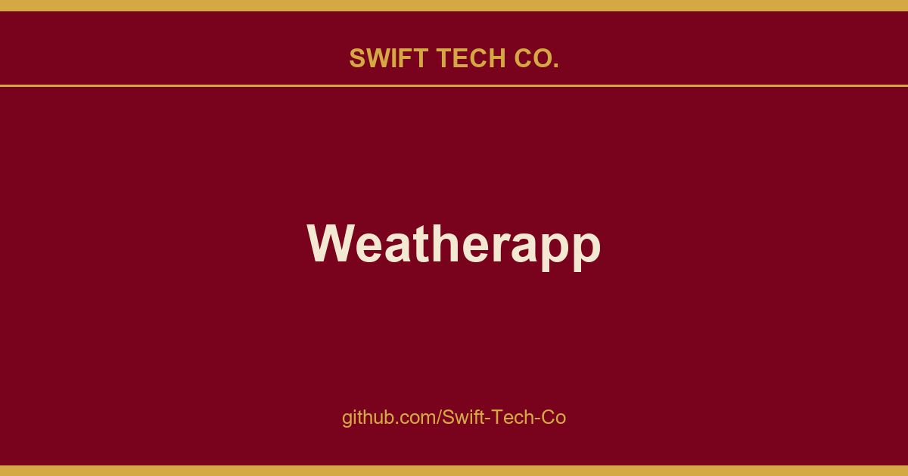

# Weatherapp

## What This Is

A practical reference entry for product and engineering: the Weatherapp notes, examples and fixes we reach for repeatedly. Kept current as part of the wider Swift Tech Co. engineering library.

## Images

## Libraries and tools 🛠

<li><a href="https://github.com/Swift-Tech-Co/Weatherapp">Navigation</a></li>
<li><a href="https://github.com/Swift-Tech-Co/Weatherapp">Shared Preferences</a></li>
<li><a href="https://github.com/Swift-Tech-Co/Weatherapp">ViewModel</a></li>
<li><a href="https://github.com/Swift-Tech-Co/Weatherapp">LiveData</a></li>
<li><a href="https://github.com/Swift-Tech-Co/Weatherapp">Transformations</a></li>
<li><a href="https://github.com/Swift-Tech-Co/Weatherapp">Data Binding</a></li>
<li><a href="https://github.com/Swift-Tech-Co/Weatherapp">RoomDB</a></li>
<li><a href="https://github.com/Swift-Tech-Co/Weatherapp">Hilt</a></li>
<li><a href="https://github.com/Swift-Tech-Co/Weatherapp">RxJava</a></li>
<li><a href="https://github.com/Swift-Tech-Co/Weatherapp">RxAndroid</a></li>
<li><a href="https://github.com/Swift-Tech-Co/Weatherapp">RxKotlin</a></li>
<li><a href="https://github.com/Swift-Tech-Co/Weatherapp">Retrofit</a></li>
<li><a href="https://github.com/Swift-Tech-Co/Weatherapp">OkHttp</a></li>
<li><a href="https://github.com/Swift-Tech-Co/Weatherapp">Moshi</a></li>
<li><a href="https://github.com/Swift-Tech-Co/Weatherapp">Stetho</a></li>
<li><a href="https://github.com/Swift-Tech-Co/Weatherapp">Picasso</a></li>
<li><a href="https://github.com/Swift-Tech-Co/Weatherapp">Material Design</a></li>
<li><a href="https://github.com/Swift-Tech-Co/Weatherapp">RxAnimation</a></li>
<li><a href="https://github.com/Swift-Tech-Co/Weatherapp">ThreeTenABP</a></li>
<li><a href="https://github.com/Swift-Tech-Co/Weatherapp">Ktlint</a></li>
<li><a href="https://github.com/Swift-Tech-Co/Weatherapp">Algolia Search API Client for Android</a></li>
<li><a href="https://github.com/Swift-Tech-Co/Weatherapp">Shadow</a></li>

## Testing 🧪
<li><a href="https://github.com/Swift-Tech-Co/Weatherapp">Mockk</a></li>
<li><a href="https://github.com/Swift-Tech-Co/Weatherapp">Truth</a></li>

## Architecture
The app uses MVVM [Model-View-ViewModel] architecture to have a unidirectional flow of data, separation of concern, testability, and a lot more.

## Dependency Graph 🔪
The following diagram shows the dependency graph of the app.

Generated by Daggraph

## Design
Inspired by Ramonyv and weather icons taken from isneezy/open-weather-icons

<h2 id="license">License</h2>
<pre><code>

Copyright (c) 2021 Furkan Aşkın

Permission is hereby granted, free of charge, to any person obtaining a copy
of this software and associated documentation files (the "Software"), to deal
in the Software without restriction, including without limitation the rights
to use, copy, modify, merge, publish, distribute, sublicense, and/or sell
copies of the Software, and to permit persons to whom the Software is
furnished to do so, subject to the following conditions:

The above copyright notice and this permission notice shall be included in all
copies or substantial portions of the Software.

THE SOFTWARE IS PROVIDED "AS IS", WITHOUT WARRANTY OF ANY KIND, EXPRESS OR
IMPLIED, INCLUDING BUT NOT LIMITED TO THE WARRANTIES OF MERCHANTABILITY,
FITNESS FOR A PARTICULAR PURPOSE AND NONINFRINGEMENT. IN NO EVENT SHALL THE
AUTHORS OR COPYRIGHT HOLDERS BE LIABLE FOR ANY CLAIM, DAMAGES OR OTHER
LIABILITY, WHETHER IN AN ACTION OF CONTRACT, TORT OR OTHERWISE, ARISING FROM,
OUT OF OR IN CONNECTION WITH THE SOFTWARE OR THE USE OR OTHER DEALINGS IN THE
SOFTWARE.
</code></pre>

---

## Swift Tech Co.

Built and maintained by Swift Tech Co.

AI Automation | FinTech Platforms | Custom Software and Mobile Apps | SaaS Platforms | Cloud Infrastructure | Cybersecurity | SEO and Marketing | API Integration

**Join our community on Telegram:** [t.me/+Qt_eFvkb2rliMzNh](https://t.me/+Qt_eFvkb2rliMzNh)

Home | Services | Careers | Referral Program | Influencers | About | Contact

**Connect**

- Website: https://github.com/Swift-Tech-Co/Weatherapp
- LinkedIn: [linkedin.com/in/stephenoladoke](https://www.linkedin.com/in/stephenoladoke/)
- LinkedIn (Company): [linkedin.com/company/swift-tech-co](https://www.linkedin.com/company/swift-tech-co)
- X: [@MrOladoke](https://x.com/MrOladoke)
- Instagram: [@mr.oladoke](https://www.instagram.com/mr.oladoke/)
- Organization: [github.com/Swift-Tech-Co](https://github.com/Swift-Tech-Co)

## Sources

Compiled and maintained from upstream [furkanaskin/Weatherapp](https://github.com/furkanaskin/Weatherapp) under permissive open-source license.

---

Maintained by [Swift Tech Co.](https://github.com/Swift-Tech-Co) - [Telegram](https://t.me/+Qt_eFvkb2rliMzNh)

## Sources

Compiled and maintained from upstream [furkanaskin/Weatherapp](https://github.com/furkanaskin/Weatherapp) under permissive open-source license.

---

Maintained by [Swift Tech Co.](https://github.com/Swift-Tech-Co) - [Telegram](https://t.me/+Qt_eFvkb2rliMzNh)

## Sources

Compiled and maintained from upstream [furkanaskin/Weatherapp](https://github.com/furkanaskin/Weatherapp) under permissive open-source license.

---

Maintained by [Swift Tech Co.](https://github.com/Swift-Tech-Co) - [Telegram](https://t.me/+Qt_eFvkb2rliMzNh)

## Sources

Compiled and maintained from upstream [furkanaskin/Weatherapp](https://github.com/furkanaskin/Weatherapp) under permissive open-source license.

---

Maintained by [Swift Tech Co.](https://github.com/Swift-Tech-Co) - [Telegram](https://t.me/+Qt_eFvkb2rliMzNh)

## Sources

Compiled and maintained from upstream [furkanaskin/Weatherapp](https://github.com/furkanaskin/Weatherapp) under permissive open-source license.

---

Maintained by [Swift Tech Co.](https://github.com/Swift-Tech-Co) - [Telegram](https://t.me/+Qt_eFvkb2rliMzNh)